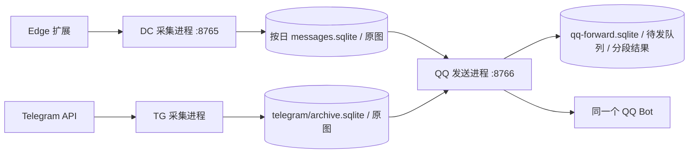

# DC / TG 采集与 QQ 发送拆分

三个进程共用项目和数据目录，独立启动、停止和重启。



DC 继续通过 Edge 扩展采集，需要对应频道页可访问。TG 使用已有加密 API 配置和会话，无需打开 Telegram Web/Desktop。只有 QQ 发送进程建立 QQ Gateway 连接并自动转发。

## 独立启动

从项目根目录，在三个终端分别运行：

```powershell
.\scripts\start_discord_collector.ps1
.\scripts\start_telegram.ps1 -Action Monitor
.\scripts\start_qq_sender.ps1
```

TG Monitor 默认持续运行；`-Seconds 60` 可限时验证。QQ 发送器每五秒检查归档并处理持久队列，TG 每轮完成后等待十秒再采集。网络、图片下载、积压和平台限流会增加延迟。

`start_discord_qq.ps1` 兼容旧启动命令：单独启动 QQ 子进程并核验健康接口，再运行 DC 采集。复用已有发送器时也核对本项目的入口路径和同一数据目录的鉴权健康接口，检查失败则停止启动。首次凭据配置需先在终端运行 `start_qq_sender.ps1`，避免后台隐藏输入。`QQ_FORWARD_ENABLED` 不再令 DC 进程启动内嵌发送器。

Ctrl+C 停止所在终端的进程。也可用 `stop_qq_sender.ps1` 单独停止 QQ 发送；采集继续。重新启动时沿用原数据目录，不能删除进度库。QQ PID 锁与 TG 文件锁阻止同一目录重复运行；旧历史/样例发送命令也共用 QQ 锁，需要先停止常驻发送器。预览不占用发送锁。

## TG 来源和起点

复制 `scripts/telegram/sources.example.json` 到 `data/telegram/sources.json`。示例包含已选的 Yekoi发言、Yekoi策略和 Yekoi → ye-koi盘中状态更新，默认全部禁用。为需要启用的来源设置 `enabled:true` 和带时区的 `enabled_at`，例如 `2026-11-25T22:00:00+08:00`。这个时间只是格式示例，实际启用时填写希望开始采集、发送的时刻。

`peer_id` 区分频道/群，`topic_id` 区分群内话题；指定话题还要提供准确的 `topic_title`。不允许同一个群的整群订阅与单个话题订阅重叠。`target:TG1` 引用已有 `qq-additional-routes.json` 中的群绑定，配置中不填写 Bot 密钥。目标必须已经有 OpenID，默认要求自身的 `channel_ids` 为空；同时接收 DC 的目标须显式设置 `allow_mixed_sources:true`，并提供不重复的有效 DC 频道编号。TG2 的 RA 路由使用此配置。修改来源配置在下一轮生效；已排队的任务在发送前仍会重新检查来源是否启用和群绑定是否匹配。

`scripts/qq_channels/yekoi/` 将指定话题的 QQ 标题统一为 `Yekoi盘中状态更新`，并在规划和发送前跳过已停用的 `telegram:-1003432435785:all` 来源。该发送规则不停止 TG 归档，也不影响其他来源。

采集器与发送器默认读取同一份 `data/telegram/sources.json`。`Monitor -Config` 仅用于单独采集验证；生产联动使用默认文件，否则发送器不会自动读取另一个路径。

`topic_id:null` 表示整群订阅，包含所有话题的消息，统一使用该群的 `all` 来源身份；指定话题时仅处理对应话题。

TG 目标须为唯一命名、已绑定并有有效 `enabled_at` 的附加路由，不能指向主群；规划和实际发送前均重新验证，重名或失效路由停止对应任务。

首次从 `enabled_at` 翻页至扫描起点，后续从上次成功完成的时间向前重叠两分钟。逐条核对正文、版本和图片 SHA-256，完整扫描成功才推进该来源的进度；中断、权限或图片错误保留旧进度，下一轮补采。一个来源失败不阻止另一个来源。首次网络连接失败也会继续重试；会话失效时需人工重新登录。

进度覆盖账号可访问且仍存在的消息。两分钟前的历史编辑、源端已删除内容和账号无权限内容不能靠增量轮询完全恢复；需要时用固定窗口 `History` 重复扫描审计。视频/文档只入库元数据，自动发送器把不能转发的附件列为 blocked。

## 持久队列与发送审计

- DC 原文和原图保留在 `data/YYYY-MM-DD/messages.sqlite` 及对应附件目录；TG 保留在 `data/telegram/archive.sqlite` 和 `data/telegram/attachments/`。
- QQ 待发队列 `sender_outbox`、逐段结果 `forward_attempts`、进度与群限速时间都在 `data/qq-forward.sqlite`。QQ 停止期间，源归档继续保存；恢复后重新规划并处理积压。
- 任务以目标群、来源频道/话题、源消息 ID、内容哈希去重。已接受的分段跳过；图片尚未就绪、上传失败或明确限流可以延后重试。此前历史补发的相同消息复用同一份发送记录。
- 发送结果不确定时标为 `unknown`，同群该源消息的其他排队版本和后续编辑版本也隔离，不自动重发；迁移前的未知发送记录同样检查。进程在 QQ 接受和本地落盘之间退出，也需要核对群内结果，无法承诺端到端恰好一次。已有已确认分段不会因队列恢复而重复发送。
- DC/TG 自动发送共用每群至少两秒间隔，文字、图片都计入；群之间分别计时，最近尝试时间重启后保留。旧主群未知发送按原规则暂停，附加群未知条目隔离后继续。
- DC 沿用 `forward_meta.start_at` 和各频道原有启用时间，首次启用发送器前的历史不会自动补发。TG 使用来源自己的 `enabled_at`。迁移时保留现有数据库，避免误变起点。

## 查看健康状态

两个 HTTP 接口仅监听 `127.0.0.1`，使用原 `collector-token.txt`，不要把令牌贴到聊天或日志。

```powershell
$headers = @{'x-collector-token'=(Get-Content .\data\collector-token.txt -Raw).Trim()}
Invoke-RestMethod http://127.0.0.1:8765/v1/health -Headers $headers
Invoke-RestMethod http://127.0.0.1:8766/v1/health -Headers $headers | ConvertTo-Json -Depth 10
Get-Content .\data\telegram\monitor-status.json -Raw
```

DC 健康状态包含最后入库时间和收到条数。QQ 状态包含 Gateway 在线状态、两个来源规划结果、blocked 原因、队列分类数量及 TG 最新扫描状态。TG 状态包含每来源读取/写入/验证数量、扫描窗口、是否完整扫描及成功进度。检查 `at` 是否持续更新；旧文件存在不代表进程还活着。

Node 日志分别写入 `data/logs/collector-YYYY-MM-DD.log` 和 `qq-sender-YYYY-MM-DD.log`。TG 在终端输出每轮摘要，同时原子更新 `monitor-status.json`。浏览器原有暂停、恢复和补发控制仍请求 8765，由采集器代理到发送器；发送器离线返回 503，消息入库仍可用。

QQ 日志按 `connection_id` 关联握手、心跳、断线与恢复。`连接错误` 记录运行时提供的异常名、错误码和有界 cause 链；`连接关闭` 即使发生在错误之后也保留关闭码、原因和 `was_clean`，不重复安排重连。异常信息中的凭据、会话标识和 URL 会脱敏；运行时没有提供原因时标为 `available:false`，不推测为 ECONNRESET。

`heartbeat_late_ms` 表示心跳定时任务实际晚执行多久，延迟达到一秒时另记警告。`event_loop_max_ms` 和 `event_loop_p99_ms` 是本连接期间 Node 事件循环延迟采样，单位毫秒；会话结束时停止采样并记录摘要。调度延迟与事件循环延迟同时升高提示本机繁忙或阻塞；调度正常时仍出现连接错误需继续排查网络和 QQ 服务端。`RESUMED` 证明会话恢复，后续 `心跳确认` 才能进一步证明连接持续响应。这些记录写入 QQ 发送器日志，不依赖 Discord 网页刷新。

DC 入库遇到临时存储故障返回 503，扩展保留原消息并按频道退避重试；身份、时间戳或 JSON 校验失败仍返回 400。采集、附件下载和发送器读取日归档时最多等待 SQLite 锁五秒；发送规划遇到数据库繁忙会在下一轮重试，不因此永久暂停。扩展 0.2.62 清理成功重试后遗留的唤醒定时器，原有频道扫描、去重规则和页面恢复逻辑保持不变。

## 本地验证

测试使用临时数据目录、虚构身份、模拟 Telegram 返回和 QQ 传输，不解密现有凭据、不连接真实 Telegram、不向 QQ 发消息。三个真实子进程覆盖：QQ 离线时两端继续入库、QQ 和 TG 同时停止时原熬鹰及熬鹰实盘仍可采集、恢复后按队列发送、再次重启不重发、各群两秒间隔、原控制 URL 代理及鉴权。另用真实 HTTP 和扩展上传队列验证存储失败后保留消息、重试只入库一次，以及日归档短暂锁定时等待后成功写入。测试结束清理临时目录和子进程。

准备独立 Python 环境并安装已有 requirements 后运行：

```powershell
$env:MUSE_TEST_PYTHON = (Resolve-Path .\data\local-validation\python\Scripts\python.exe).Path
$nodeTests = @(Get-ChildItem -LiteralPath test -File | Where-Object { $_.Name -match '\.(cjs|test\.js)$' } | ForEach-Object { $_.FullName })
node --test @nodeTests
& $env:MUSE_TEST_PYTHON -m unittest discover -s test -p 'test_telegram_*.py'
```

没有 `MUSE_TEST_PYTHON` 时跨语言三进程测试会明确跳过。所有进程可通过 `MUSE_DATA_DIR` 使用另一个数据根目录；HTTP 端口分别用 `MUSE_COLLECTOR_PORT`、`MUSE_QQ_PORT` 覆盖。首次从旧的混合 DC+QQ 进程迁移时，要先停止旧进程，再启动这三个进程。运行测试使用隔离数据，不修改远端运行状态。

2026-11-26 本地完整回归通过 117 项 Node 测试和 28 项 Python 测试，无排除或跳过，覆盖 Gateway 诊断、时间戳补全与异常记录、RA 与 TG 共群、Yekoi 发送规则及有限恢复监控。三个业务进程已在远端拆分运行，RA 扩展 v0.2.64 和发送路由已单独部署验证；本次 GitHub 发布不部署其余本地改动，远端尚未安装新的服务监控计划任务。本地测试验证故障注入与模拟传输，线上状态仍须结合实际进程、扫描和 Gateway ACK 核验。
