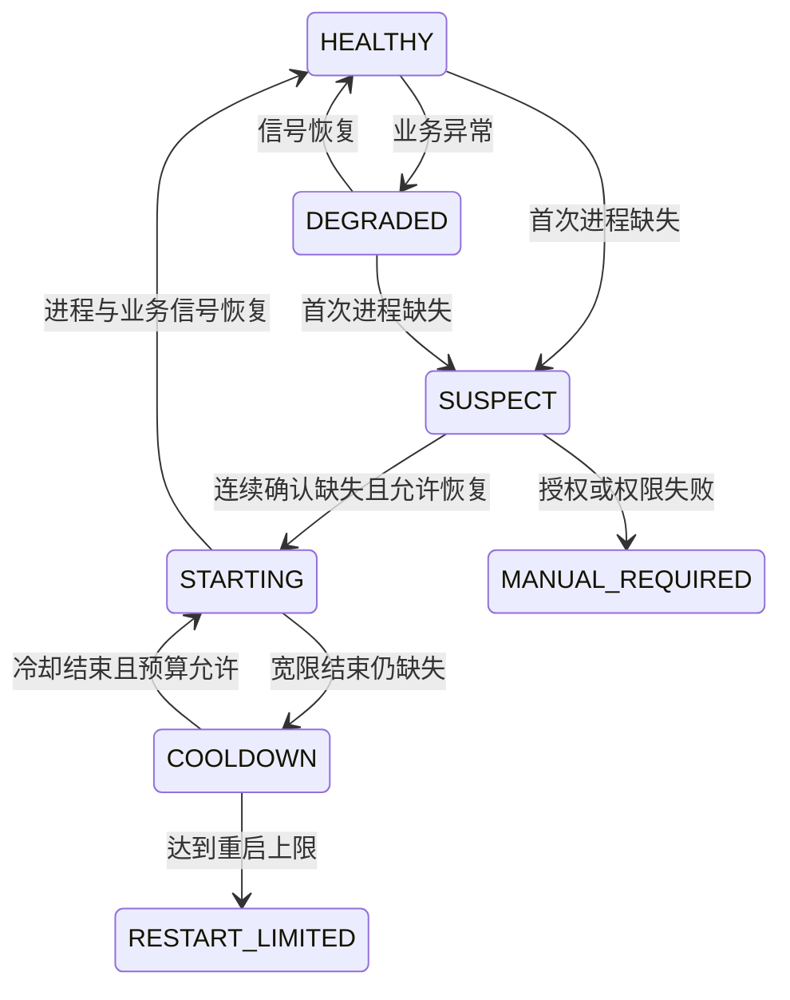

# DC / TG / QQ 有限状态巡检（本地验证版）

2026-11-26 在本地实现并测试。本次仅通过 SSH 读取远端异常，没有部署代码、安装任务、启动或停止远端进程。此前的 `collector-watchdog-plan.md` 是交接方案，本文记录本地实现。

## 读取到的远端异常

- TG 在北京时间 2026-11-26 04:09 左右因 Telethon 连接关闭警告触发 PowerShell 异常，最后成功扫描为 04:08:57。现有提交 `a4f6c4f` 已修正启动器：保留 stderr，以 Python 实际退出码判断失败。本次复跑本地验证，不重复修改该修复。随后只读检查中 TG 已运行；这不是本次巡检启动的。
- Python 虚拟环境存在启动器和实际 Python 的父子进程。两个相同命令行的 PID 可以属于同一个实例，不能当作重复采集杀掉。
- QQ 存在明确限流、原图 HTTP 404 和历史 `unknown` 发送记录；DC 日志存在较早的频道扫描无响应记录。这些是分类依据，旧日志本身不证明目前仍故障。
- QQ 健康接口 `running` 表示当前正在执行一轮工作，空闲时为 false；不能据此判断常驻进程退出。

## 状态机及动作

`scripts/service_monitor.cjs` 每次完成一个观察、判断、执行和落盘循环，三个角色各自维护状态、预算、首次异常时间、连续失败次数和最后成功时间。默认仅观察，显式 `--recover` 才允许启动。

| 状态 | 含义与动作 |
| --- | --- |
| HEALTHY | 进程和业务信号正常；不需要新消息或新增入库才能健康 |
| DEGRADED | 进程存在但业务异常、信号陈旧，或启动器存在而业务进程缺失；记录具体异常，不杀进程 |
| SUSPECT | 首次未发现进程；等待下一轮确认 |
| STOPPED | 已确认缺失；观察模式只记录，恢复模式检查预算后拉起对应角色 |
| STARTING | 已请求启动，给 120 秒宽限；不再次启动 |
| START_FAILED | 启动调用失败，记录原因并消耗一次预算 |
| COOLDOWN | 距上次恢复不足 5 分钟，等待 |
| RESTART_LIMITED | 每角色滚动一小时已启动 3 次，停止自动恢复直到预算窗口腾出 |
| CONFLICT | 进程缺失但端口或健康接口仍存在，记录身份冲突，不启动 |
| MANUAL_REQUIRED | 进程缺失且最近业务状态显示授权或权限异常，等待人工处理 |
| PAUSED | 存在人工暂停标记，不启动 |
| INSPECTION_FAILED | 进程/端口检查失败、鉴权文件不可读；不能确认缺失，不启动 |



进程按本项目完整入口匹配；TG 还核对 `monitor` 参数和数据目录，并合并 Python 父子链。DC/QQ 同时检查端口归属和鉴权健康接口。识别不到准确归属时只记录冲突；不终止任何进程。

网络、限流、授权、权限、SQLite/数据、图片和发送未知分开记录，包含错误发生时间与处理建议。已有进程的网络重连、限流退避与附件重试继续由业务代码处理。`unknown` 始终标记为隔离、禁止自动重发；巡检对业务数据库只读。

DC 健康接口新增当前页面清单和报告时间、最近入库/校验错误。即使页面清单内容没变，时间也随上报更新。TG 状态新增每轮开始/结束、当前阶段、每来源进度与脱敏错误说明；补采过程中每十秒有消息进展时刷新状态，长时间无进展只提示异常，不重启活进程。

QQ 心跳从当日和前一日各最多 128 KiB 日志尾部读取 ACK；不会把发出心跳或 HTTP 响应当作 ACK。规划结果超过 5 分钟未更新会记录异常。队列记录最老来源时间、最老状态更新时间及持续观测时间；来源已过 15 分钟且待发状态长时间未变化或持续积压才提示。原表没有入队创建时间，因此持续观测时间是巡检看到的积压时长下界，不能解释为精确入队时长。

## 输出和暂停

- `data/monitor/status.json`：统一快照，原子替换。
- `data/monitor/state.json`：状态和重启预算；禁止通过删除该文件绕过上限。
- `data/monitor/events-YYYY-MM-DD.jsonl`：按北京时间日期记录异常打开、变化、解除、状态迁移、启动和退出。
- 启动产生独立 stdout、stderr 和退出结果 JSON；记录 PID、角色、启动原因、退出时间及实际退出码。请求启动只表示已创建启动器，下一轮仍检查业务进程。
- 创建 `data/monitor/pause-all` 或 `pause-discord` / `pause-telegram` / `pause-qq` 可暂停对应恢复；需要人工停止业务时先创建标记。

巡检文件锁拒绝重叠运行；预算在执行启动前落盘，巡检崩溃也不会漏记一次恢复尝试。状态文件损坏时直接失败，不能按空预算继续恢复。令牌只在内存参与 HTTP 鉴权，输出会脱敏；不记录正文、密钥或会话。

## 本地验证

```powershell
$env:MUSE_TEST_PYTHON = (Resolve-Path .\data\local-validation\python\Scripts\python.exe).Path
node --test test/service_monitor.cjs test/collector_page_status.cjs test/telegram_launcher.cjs test/collector_storage_retry.cjs test/collector_processes.cjs
.\data\local-validation\python\Scripts\python.exe -m unittest discover -s test -p 'test_telegram_monitor.py'
```

测试使用临时目录、模拟健康接口和时钟；实际子进程验证也只启动临时项目中的模拟角色。覆盖逐角色退出只启动对应角色、连续缺失确认、冷却、上限、预算持久化、授权失败、暂停、并发锁、进程身份、Python 父子链、空扫描、长补采、业务异常、日志脱敏及 `unknown` 数据不变。2026-11-26 验证：相关 Node 测试 26 项、Telegram Python 测试 28 项通过，无跳过；PowerShell 脚本语法检查通过。

Windows 实测发现 Node `detached:true` 启动隐藏 PowerShell 时可能退出但不执行脚本，因此实际恢复用隐藏的 `Start-Process` 创建包装器。本地临时项目已验证警告保留和原生退出码 0 / 7 落盘，不以仅拿到 PID 作为恢复完成。

`check_services.ps1` 是手动巡检入口，默认只观察；`-Recover` 才启动恢复。`install_service_monitor.ps1` 为后续部署准备了一分钟周期的 Windows 任务定义，本次没有执行。未来安装必须以业务凭据所属 Windows 用户执行，默认项目数据目录，交互登录会话；本地测试不能证明远端任务调度、用户注销或机器重启后的行为。

## 按角色恢复入口

`scripts/recover_services.ps1` 提供 Status / Recover / Pause / Resume 四种动作，默认 Status，只记录观察结果。Role 可选 all / discord / telegram / qq。所有动作针对运行脚本的本机和 `MUSE_DATA_DIR`，不含 SSH、远端部署或远端进程控制。

```powershell
.\scripts\recover_services.ps1 -Action Status
.\scripts\recover_services.ps1 -Action Recover -Role telegram
.\scripts\recover_services.ps1 -Action Pause -Role telegram
.\scripts\recover_services.ps1 -Action Resume -Role telegram
```

Recover 仍检查全部三个角色，但只允许指定角色进入原有的限次启动分支。它不提供强制重启、杀进程或预算清零功能。连续两次确认缺失、启动宽限、冷却、滚动预算、授权/权限阻断和端口归属检查继续生效；重复手工调用也不能绕过。

Pause 只暂停巡检恢复，不停止业务进程。Resume 只删除选中的暂停标记，不立即启动。Resume all 只移除全局暂停，保留各角色的单独暂停；Resume telegram 遇到全局暂停时仍不能恢复。暂停操作写入统一事件日志，不修改重启预算。手工维护业务前，应先暂停对应角色。

## 告警交给 Codex 诊断

本地链路为：巡检状态和异常 → 脱敏告警包 → 可选 Codex 诊断 → 校验后的建议文件。自动恢复由原状态机执行，诊断结果只落盘，不执行模型返回的命令。

- `data/monitor/handoff/<role>.json` 保存各角色最近一轮故障。每轮有稳定 ID 和修订号，重复观察不会新建故障；状态、错误类别、恢复次数或退出结果变化才增加修订号。恢复后标记 RESOLVED，人工暂停标记 SUSPENDED，再次异常创建新 ID。
- 告警包通过字段白名单构造，只包含角色、状态、固定异常代码/类别、发生时间、计数、恢复次数和退出码。不包含原始异常文本、消息正文、来源 ID、完整日志、命令行、项目路径或凭据。具体错误仍留在本机状态和事件日志，需要更多证据时由人工补充。
- `unknown` 的处理规则始终为 `quarantine_no_retry`；允许建议只有 observe / manual_review / recover_via_fsm。运行中的业务错误不会向模型开放恢复建议。recover_via_fsm 也只代表重新走巡检规则，不代表无条件启动。
- 告警包生成失败会保留已落盘的启动预算、在状态中标记 HANDOFF_WRITE_FAILED，并使命令失败退出，避免把恢复成功与告警写入成功混为一谈。

先仅生成诊断材料，不联机、不调用模型：

```powershell
.\scripts\diagnose_monitor_alert.ps1 -Role telegram
```

输出目录为 `data/monitor/codex/<故障ID>-r<修订号>/`，内含 request.json、prompt.txt 和 response.schema.json。同一修订号复用同一目录。已解除或暂停的告警拒绝提交。

后续需要实际交给本机已登录的 Codex CLI 时，显式增加 Submit：

```powershell
.\scripts\diagnose_monitor_alert.ps1 -Role telegram -Submit
```

Submit 会使用本机 `codex exec`，从 stdin 传入脱敏包，以 `--ignore-user-config --ephemeral --sandbox read-only --skip-git-repo-check` 运行，并用 `--output-schema` 约束回执。诊断工作目录是项目之外的独立临时目录，只放提示词和结构定义；提示词要求只分析输入，不调用工具或接触服务。未更改用户的 Codex 配置。当前参数已按本机 Codex CLI 0.166.0 的 `codex exec --help` 核对，真实账号、联网调用、模型兼容性尚未联调。它不向当前桌面聊天自动插入消息。

默认 300 秒超时，TimeoutSeconds 可设 10–900 秒；超时时结束本次创建的本地诊断进程树。同一任务使用独占提交锁，已有有效回执就不重复提交。成功后校验故障 ID、修订号、角色、允许动作、证据代码和字段结构，再写入 response.json；额外的 command 字段、未知发送重试动作等会被拒绝。回执到达时重新比较当前故障；已变化、解除或暂停则标记 current=false。无论 current 值如何，当前脚本都不会应用模型建议。

未来可以增加“异常持续或自动恢复耗尽后触发 Submit”的本地适配器，以及审核后调用 Recover 的执行入口；仍须重新读取最新状态并检查原有预算。当前未安装定时上传或模型自动修复功能。原 QQ 私聊告警仍由原 QQ 代码处理，独立巡检尚未接入私聊通知，也未发送测试私聊。

新增验证：

```powershell
node --test test/service_monitor.cjs test/monitor_diagnosis.cjs
```

使用临时数据和模拟 Codex 命令验证角色选择、暂停层级、预算保留、告警脱敏/去重/解除、回执拒绝、过期标记、默认不提交、同一修订只提交一次，以及非零退出与超时处理。模拟提交实际经过 Windows PowerShell 包装器，不消耗模型调用，也不读取远端。

2026-11-26 本轮相关 Node 测试 37 项通过，无跳过，包含三个业务进程的本地联测；新增 PowerShell 脚本语法检查通过。未执行真实模型调用、远端恢复或定时任务安装。
