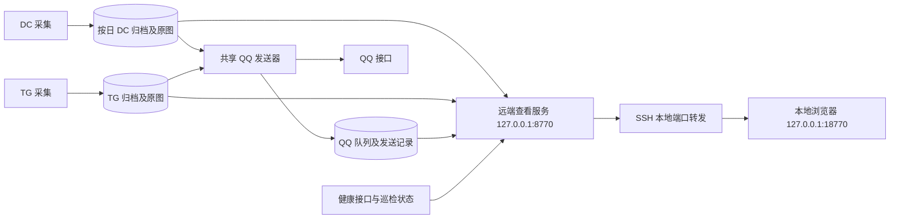

# DC / TG 采集与 QQ 发送查看后台方案

状态：设计已入库，尚未实现或部署查看服务。核对日期：2026-11-27，北京时间。

## 目标与接入方式

在本地浏览器查看远程的 DC 采集内容、TG 采集内容、QQ 发送内容及处理状态。日常查看通过页面完成，包括原文、原图、编辑版本、目标群、发送分段、失败原因和单条耗时。

采用“远端只读查询服务 + 本地端口转发”。这里的透传对象是查询结果与按需加载的图片；权威归档仍在远端。使用者启动本地入口后直接打开页面，底层可以继续使用现有 SSH 密钥和严格主机校验，无需手动登录远端执行查询命令。这个方案并不是完全移除 SSH。



端口是拟定值，实施前检查占用。前端静态页面和查询 API 由同一个查看服务提供，经同一通道访问。查看服务独立于三个业务进程；它停止时采集和发送继续运行。

首版不做远端向本地持续复制整库。TG 当前使用 SQLite WAL，跨机器共享目录打开活动库不适合作为这个方案的接入方式；需要离线副本时另外生成一致性快照，不能只复制活动的 `.sqlite` 主文件。依据：SQLite 官方 WAL 与 Online Backup API 文档，见文末。

## 已核对的现状和版本边界

本地基线提交 `bd38098`。已通过现有 SSH 辅助脚本验证连接，列出远端根目录、读取进程入口、鉴权健康接口、状态文件和指定数据库表结构。未修改业务进程或发送配置。

远端入口分别为 `scripts/discord_collector_server.cjs`、`scripts/telegram/collector.py monitor`、`scripts/qq/sender.cjs`。TG 的虚拟环境启动器与实际 Python 子进程属于同一父子链，不能仅凭两个 Python PID 判断重复采集。

抽查 12 个关键文件的 SHA-256，8 个字节一致；另有 2 个只在 CRLF/LF 换行上不同，统一换行后内容一致；以下 2 个存在实际代码差异：

| 文件 | 远端相对本地的差异 | 对后台的影响 |
| --- | --- | --- |
| `scripts/qq/core/telegram_source.cjs` | 缺少本地 Yekoi `forwardingEnabled` 检查 | 页面必须分别展示“已采集”和“当前允许转发”；不得用本地规则解释远端的实际排队行为 |
| `scripts/qq/core/gateway.cjs` | 尚无本地新增的结构化错误、事件循环延迟与心跳调度延迟采样 | 旧版未记录的诊断字段返回不可用，不能补出数值 |

其他已抽查文件包括 DC 服务、QQ 入口/forwarder/outbox、TG collector/archive/monitor、service monitor、DC 附件队列和扩展 manifest。扩展磁盘 manifest 为 `0.2.64`；尚未由浏览器确认实际加载版本。

这些结果证明的是远端磁盘文件与进程入口，不能证明所有常驻进程内存中加载的代码与磁盘完全一致。后台版本信息应分别标明服务启动时间、部署文件哈希、实际运行版本（若启动时有记录）；未知字段明确显示未知。项目根 `VERSION` 仍是早期 OCR 说明，不能作为这三个进程的统一版本号。仓库 `src/dashboard.js` 属于市场区间预警功能，本次另设查看后台入口。

2026-11-27 约 14:11 的只读快照中，QQ 健康接口在线、TG 扫描状态持续更新；这是当时的快照，不能作为以后打开页面时的状态。

## 页面设计

采用左侧导航、顶部状态条、中间内容列表、右侧单条详情的布局。默认进入“实时总览”，桌面可并排看 DC、TG、QQ；窄屏切换标签。详情中的完整正文可复制，原图点开查看。

```text
┌ 顶部：远端连接 / DC 状态 / TG 状态 / QQ 状态 / 最后刷新 / 数据陈旧提示 ┐
│ 导航        │ 来源、频道/话题、目标群、时间、状态、正文搜索            │
│ 实时总览    │ DC 最近入库     TG 最近入库      QQ 最近处理           │
│ DC 内容     │ 正文 + 缩略图   正文 + 缩略图    发送正文 + 图片 + 结果 │
│ TG 内容     │                                                       │
│ QQ 队列     │ 点击任意消息 → 右侧详情：原文 / 图片 / 各目标群追踪    │
│ 连接与异常  │                                                       │
└─────────────┴───────────────────────────────────────────────────────┘
```

| 视图 | 必须实时可见的内容 | 主要筛选 |
| --- | --- | --- |
| 实时总览 | DC/TG 新入库消息和 QQ 当前处理内容；待发数、最老等待、异常数；进入详情 | 来源、频道/话题、目标群 |
| DC 内容 | 完整正文、作者、图片、原消息时间、首次入库、最近观察、版本、图片完整性 | 频道、入库/原消息时间、文字、附件状态 |
| TG 内容 | 完整正文、频道/话题、相册、图片、原消息时间、首次入库、编辑版本、图片完整性 | 频道、话题、时间、文字、附件状态 |
| QQ 队列与记录 | 来源原文、准备发送/实际提交正文、图片及分段；目标群、当前段、状态、阻塞依据、次数、下次重试、接口回执 | 群、来源、频道、实时/补发、待发/已接受/异常 |
| 连接与异常 | DC 页面扫描、TG 每来源扫描进度、QQ 在线/ACK/断线、巡检恢复、接口错误 | 角色、时间、错误类别 |

新内容提示可自动刷新，阅读旧消息时保留滚动位置并显示“有 N 条新内容”。分页默认 50 条，上限 100 条；默认最近 24 小时，可改为明确时间范围。正文列表折叠，详情完整展示。所有时间显示北京时间，悬停显示原始带时区时间。

QQ 必须显示内容，不能只有计数或成功标记。原文与经过标题拼接、正文转换、拆段后的 QQ 内容并排可查。一条消息发往多个群时，每个群独立列出进度；主群和附加群的 unknown 隔离/暂停规则按现有运行逻辑展示。

## 现有数据如何接入

下列路径均相对远端数据根目录，支持 `MUSE_DATA_DIR`。查看进程使用独立的只读连接，不能直接 require 会初始化队列、创建表或启动发送的业务模块。

| 数据 | 当前来源 | 接入注意点 |
| --- | --- | --- |
| DC 文字和版本 | `YYYY-MM-DD/messages.sqlite` 的 `discord_web_messages`、`discord_web_observations` | `captured_at` 是该日该版本首次保存时间；重复观察单列。跨日可能重复归档同一消息，应按来源身份与版本合并，同时保留日库定位 |
| DC 图片 | 同库 `discord_web_attachment_files`、`discord_web_attachment_jobs` | 按消息附件清单核对数量、落盘状态、下载次数、下次尝试与文件存在性 |
| TG 文字和版本 | `telegram/archive.sqlite` 的 `telegram_messages` | 首次入库用 `first_observed_at`；`last_observed_at` 不能充当首次入库或持续变化订阅游标 |
| TG 图片 | `telegram_attachments` | 保留 pending/saved/failed/metadata_only 等原始状态；视频/文档仅元数据，不能显示成图片下载成功 |
| TG 话题与相册 | 消息 `payload_json` 中的话题信息、`grouped_id` | 话题不是 `telegram_messages` 的独立列；相册的多条消息聚合展示，并保留每条身份 |
| QQ 常规队列 | `qq-forward.sqlite` 的 `sender_outbox` | 有任务、来源、群、消息快照、状态、下次重试、次数和最近更新时间；没有不可变的首次入队时间 |
| QQ 分段与结果 | `forward_attempts` | 每个 task/part 保存当前记录，重试会覆盖；`platform_message_id` 表示接口回执，缺少完整历史和实际提交正文 |
| QQ 历史补发 | `replay_requests`、`replay_items` 和分段 `origin/replay_request_id` | 部分补发直接调用发送逻辑，不经过常规 outbox；队列页必须联合展示，否则会漏掉正在占用发送的补发 |
| DC 连接与页面 | 鉴权 `127.0.0.1:8765/v1/health` | 有最近入库、页面上报和存储/校验错误；长时间没有新消息本身不是断线 |
| TG 采集进度 | `telegram/monitor-status.json`、`telegram_monitor_state` | 分开显示轮次开始/结束、阶段、各来源扫描成功时间与水位 |
| QQ 与巡检 | 鉴权 `127.0.0.1:8766/v1/health`、`monitor/status.json`、`monitor/supervisor-status.json` | `running` 是是否正执行一轮，false 不等于退出。巡检通常按分钟更新，不能伪装成每两秒重新巡检 |
| 心跳和故障记录 | 已定位的按日 QQ 日志、`collector-diagnostics.sqlite`、`monitor/events-YYYY-MM-DD.jsonl` | 按日期和有界日志尾部读取；区分心跳已发、已确认及连接恢复。当前诊断库的 channel_id 校验仅支持 DC 数字 ID，不能直接用于 TG 身份 |

DC 查询必须区分“原消息日期”和“归档日期”：历史消息可能今天才入库。不能根据原消息日期只打开同名日库，否则补采内容会漏掉。首版维护日库目录清单，按明确范围限量查询；跨日来源定位必要时放入查看服务自己的可重建索引，不修改业务数据。

## 图片完整性

每条消息展示“预期图片数 / 已保存数 / 缺失数”，逐图展示下载状态与错误。`saved` 但本地文件不存在应显示缺失；文件存在但未校验显示“存在，未校验”，不直接标记完整。

原图通过附件 ID 请求，由服务查询已登记的本地路径并校验允许目录、真实路径及文件类型。浏览器不能提交任意文件路径，也不暴露整个 data 静态目录。默认懒加载缩略图，点开取原图；缩略图缓存写到独立查看缓存。SHA-256 校验按需或后台限量执行，不在每轮刷新中重算所有图片。

“完整”仅指已采集附件清单与本地文件一致，不能证明源页面没有漏识别附件。采集端报告 missing_image、下载失败、来源附件无权限时单独提示。

## 单条追踪与需要补记的字段

关联身份为 `source + channel/topic + source_message_id + content_sha256`；发送关联再加目标群与 `task_key`，分段再加 `part_index`。所有平台 ID 按字符串传递。DC 详情保留归档日期与行 ID，避免不同日库行号碰撞。

时间轴展示：源发布 → 首次观察/入库 → 附件就绪 → 首次入队 → 首次发送尝试 → 各段 QQ 接口接受。缺失时标记“历史未记录”，展示已知部分；不得把 outbox 的 `updated_at` 当作首次入队，也不能把某段接受时间当成整条完成时间。

现有 `forward_attempts.attempted_at` 随状态覆盖，accepted 行的时间是本地记录接受结果的时刻；它不是精确的 HTTP 请求开始时间。只有所有必需分段已接受才显示整条接受完成。`unknown`、跳过图片、去重跳过和部分成功必须分别展示。QQ 接口接受不代表手机或群成员已收到。

为满足首版 QQ 实际内容和完整后续追踪，实施时需由业务写入方补记：

| 补记内容 | 写入位置与规则 |
| --- | --- |
| `enqueued_at` | outbox 第一次插入时记录，冲突更新时保留；旧行留空并标记历史缺失 |
| 阶段事件 | 业务事务内追加持久记录，含事件 ID、身份、task/part、阶段、发生时间、目标与脱敏原因；重试不覆盖旧事件 |
| 实际发出内容 | 在每次 HTTP `/messages` 调用前保存本次正文、类型、源图片引用/哈希、请求开始时间；返回后追加接受/失败/未知结果和回执 ID |
| 退避与阻塞依据 | 记录离线、群暂停、来源关闭、图片待就绪、上传失败、限流冷却、unknown 隔离、身份冲突等分类和具体依据 |
| 运行版本 | 业务进程启动时记录自身版本/部署清单；磁盘哈希变化不能自动等同内存代码变化 |

实际发出内容包括补发、图文回退为文字再发图等分支。不得保存 Bot 密钥、HTTP 鉴权头、上传 base64 或 QQ 临时 file_info。复用已有本地图片，正文与事件放在受控数据目录，不提交 Git。

查看服务只读上述事件。业务事件优先与原状态使用同一业务库事务，避免为了审计让一个进程写入另一个正在使用的业务库。提交后的事件可由查看服务轮询合并；事件写入失败不能静默变成“发送成功且已审计”，应留下可见的审计缺失状态，并沿用已有发送结果不确定时的保护。

旧数据只能展示记录或按当前规则重建的“预览”，明确标注“重建预览，非当次实际发送记录”。不能承诺恢复未保存的历史正文、全部重试过程或精确排队耗时。

此前提供的 Yekoi 案例为 2026-11-26：14:25:40 发布、14:25:53 首次入库、14:27:54 接口接受，合计 134 秒，其中采集 13 秒、入库到接受 121 秒。这是前序排查结论，本次未重新读取该条内容复核；时间轴验收可用人工构造的相同时差样例，不把样例当实时数据。

## 实时刷新与接口草案

首版用每 2 秒一次增量轮询，连接状态每 5 秒刷新。目标是在远端记录提交后 3 秒内更新页面（正常网络、小规模单用户负载下的验收目标，实施后实测）；这是页面观察延迟，不是 TG/DC 平台发布到采集或 QQ 送达的承诺。TG 当前采集每轮完成后等待约 10 秒，不能靠前端消除这部分时间。

接口统一 `/viewer/v1/`，均为查看服务新接口，不冒充已存在的业务 API：

| 接口 | 返回内容 |
| --- | --- |
| `GET /overview` | 三路状态、来源/目标群统计、各数据源采样时间与陈旧状态 |
| `GET /messages?source=&channel=&topic=&from=&to=&cursor=&limit=` | DC/TG 消息正文、版本、附件摘要和发送关联 |
| `GET /messages/:id` | 单条完整内容、各版本和图片 |
| `GET /queue?group=&source=&status=&origin=&cursor=` | 常规待发与历史补发的统一列表、原因依据、下次尝试 |
| `GET /sends/:taskKey/parts` | 预览/实际正文、逐段图片、尝试历史和接口回执 |
| `GET /trace/:id` | 按各目标群展开的时间轴与已知耗时 |
| `GET /attachments/:id` | 允许目录内已登记的图片或明确的缺失结果 |
| `GET /changes?cursor=` | 新增与状态变化的实体 ID、版本、下一游标、是否需重新同步 |
| `GET /connections`、`GET /errors?role=&from=&to=` | 连接快照和有界错误记录 |
| `GET /version` | 查看 API schema 版本、服务版本、业务能力与版本已知程度 |

不能只按最大消息行 ID 追增量：旧消息图片完成、QQ 重试、版本观察都会更新旧记录。新增阶段事件按持久序号读取；旧表过渡期分别跟踪更新时间/行 ID，使用重叠窗口及去重，并定期重读当前可见消息和未完成任务。游标包含各来源进度，读多库不是跨库原子快照，每项附带采样时间。事件清理后游标失效返回 resync，重新拉取快照。

刷新失败保留最后内容，明确显示“连接中断，数据截至某时”，单个来源失败只让该来源陈旧。重新连接后先核对快照，再补增量；不能断线后直接清空待发数或显示为 0。大量积压时限制单次增量数并持续分页，避免每两秒全库扫描。

后续需要更低观察延迟时，可把 changes 通道升级为 SSE，并按持久事件游标重放。标准 EventSource 支持连接重建及 Last-Event-ID，但应用仍需实现事件保留和补数，不能把 SSE 本身当作持久队列。

## 访问与运行约束

- 查看服务只监听远端回环地址；本地转发也只绑定本地回环地址。现有连接辅助配置、主机地址、密钥和固定主机指纹继续保存在忽略文件中，不写入仓库。
- 使用独立查看凭据，浏览器不能拿到具备暂停、补发权限的 collector token。查看服务如需调用现有 health，只在服务端使用原令牌。初次凭据配置及一键入口在实施时完成，令牌不放 URL 或日志。
- 查询和附件都鉴权；浏览器可用请求头读取附件后生成 blob 预览。正文作为文本展示；不执行采集内容中的 HTML，不自动加载原文内的外部图片。
- 查询连接 readOnly，禁止执行来自浏览器的 SQL。分页、范围与正文搜索设上限；短事务、短 busy timeout，繁忙时返回暂不可用并重试。只读访问也要限制查询耗时，避免长读影响业务写入。
- 首版查看页面没有补发、删除、启停进程按钮。已有发送控制接口不通过查看服务透传；后续确需控制时再独立设计动作和鉴权。
- 不为首版新增公网域名、开放路由端口或云中转。若以后要求底层也完全不用 SSH，再选择受认证的专用网络/HTTPS 接入，查询 API 保持不变。

## 与发送调度修复的关系

当前已按群保存至少 2 秒的发送间隔，但 `outbox.drain(100)` 仍逐条 await，同一个 tick 还先处理历史补发。按群计时不等于按群并行推进，跨群仍可能相互等待。

后台负责把等待展示清楚；调度修复另作业务变更：每群单一执行链、群间限量并发、所有实时/补发/修复路径共用同一个群限速与执行入口；实时优先且历史保留公平份额，避免长期饥饿。同群仍遵守顺序、间隔、限流冷却和 unknown 保护。不能只把外层 for 改成 Promise.all，否则同群路径可能竞争并破坏原保护。

后台展示任务类型、当前占用群与已有证据。旧版没有调度等待事件时只能显示“待调度，详细原因未记录”，不能把任意积压直接归因为 Discord。观察服务不能参与业务排队或占用发送串行循环。

## 实施顺序与验收

1. **只读接入与内容页面**：独立查看服务、两端归档查询、图片预览、QQ 现有队列/补发/分段、连接状态、本地一键端口转发。QQ 旧记录标明重建预览，阶段缺口如实展示。这是可用的过渡版。
2. **完成首版要求**：补记不可变入队时间、实际发送正文、阶段/重试事件、运行版本。覆盖实时发送、补发和回退路径，使 DC/TG/QQ 都有实时内容，单条能追踪至 QQ 接口接受。这一步完成才算完整首版。
3. **调度修复**：在已有保护和后台观测下验证跨群推进、实时与历史公平调度；作为单独改动上线，避免将页面观察速度与发送提速混为一谈。

验收使用隔离数据库、模拟 QQ 传输与构造图片，不向真实群发送测试消息：

- DC 和 TG 各有文字、纯图、多图/相册及编辑版本，三路页面都能在目标观察延迟内出现内容；QQ 实际正文与模拟传输收到的 payload 一致。
- 新图片从 pending 到 saved 时无需新增消息也能刷新；文件缺失、失败和仅元数据都明确展示。原图与归档哈希一致性可按需核验。
- 同一源消息跨日归档、多个内容版本、多个目标群及补发请求均正确关联，无日库行 ID 串线或漏项。
- 部分接受、限流重试、上传失败、unknown、来源停用和群暂停分别展示；unknown 不触发自动重发。完整重试历史仅对开始补记后的事件承诺。
- 断开本地通道、停止查看进程或单个业务服务，其他业务继续；页面保留旧数据并标明其时间，重连后补齐变更。
- 旧库无新增字段、旧 Gateway 无新诊断字段时仍能打开，显示能力缺失；不自动改变数据库结构或开启原本停用的来源。
- 首次入队耗时按新字段计算，旧数据明确缺失；源发布时间到入库、入库到各段接口接受的计算可用 13 秒/121 秒样例验证。
- 验证鉴权、正文转义、附件目录边界及有界分页。上线前记录代表性积压下的查询耗时和业务写入影响，达不到预算则缩小读取窗口或使用可重建查看索引。

## 参考

- SQLite 官方 Write-Ahead Logging：`https://sqlite.org/wal.html`，同机访问、WAL 文件与只读限制。
- SQLite 官方 Online Backup API：`https://sqlite.org/backup.html`，活动库一致性快照。
- WHATWG HTML Server-sent events：`https://html.spec.whatwg.org/multipage/server-sent-events.html`，事件流重连与 Last-Event-ID。

本次交付是方案与版本核对结果。未部署查看服务、建立长期转发通道、补记业务字段或修改发送调度。
